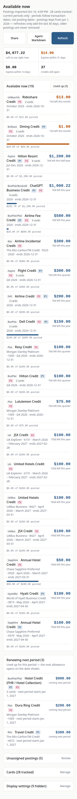

# Credit Card Coupon Book Dashboard

Track every Amex and Chase statement credit across all your cards — and actually use them before they expire.

If you hold multiple cards (Amex Platinum, Business Platinum, Business Gold, Hilton Aspire, Marriott Brilliant, Chase Sapphire Preferred…), each card carries statement credits on different cycles: monthly, quarterly, semi-annual, annual — and some run on your cardmember anniversary year instead of the calendar year. They are easy to forget and issuers do not roll them over. This dashboard pulls your real credit postings from Plaid, matches them against a built-in catalog of each card's credits, and shows — per current period — how much you have used and how much is left, grouped by credit type across cards.



*The dashboard in real use (mobile width, full page): one household, two cardholders — shown as P1 and P2 — with every tracked credit's current-period used and remaining amounts.*

## Supported cards (verified)

"Verified" means two things, and both are required: the card has catalog definitions in this repo (`server/src/actions.ts`), **and** unit tests pin those definitions down — the catalog tests assert each card's credit amounts, cycles, posting-name patterns, and anniversary anchors, and the DB-backed suites exercise the Chase products end to end. Exactly these nine cards qualify:

- Amex Platinum
- Amex Business Platinum
- Amex Business Gold
- Hilton Honors Aspire
- Marriott Bonvoy Brilliant
- Chase Sapphire Preferred
- Chase World of Hyatt Business
- Chase IHG One Rewards Premier
- The Ritz-Carlton Card

Any other card is **not yet supported**. In particular, Chase United cards (e.g. United Explorer) have **not** been verified and count as unsupported: an unsupported account can still show up via Plaid, but its credits are not tracked until a catalog entry exists for it.

## Contributing

New cards are added by **pull request** — that is the only path to "supported":

1. Fork the repo and add the card's catalog definitions (amounts, cycles, posting-name patterns, anniversary anchor) in `server/src/actions.ts`.
2. Add unit tests for the new card: at minimum a catalog test asserting its definitions, following the existing per-card tests in `tests/catalog.test.ts`. **No tests, no "verified"** — a card joins the list above only once its tests land.
3. Run `bun test` and `bun run typecheck` — both must be green.
4. Open the PR describing the card's published benefit terms and where each amount/pattern comes from.

The intended workflow is to let your own Muse (or another AI assistant) prepare the PR for you: point it at this repo, have it follow [SETUP_FOR_MUSE.md](SETUP_FOR_MUSE.md), and ask it to add the card with its tests and open the pull request.

## Features

- **Real usage, not guesses** — usage is computed from the actual statement-credit postings on your accounts (e.g. `Platinum Lululemon Credit`, `AMEX Flight Credit`), never inferred from spending.
- **Transaction-date attribution** — a credit counts toward the period of the underlying transaction (`authorized_date`), not the day the issuer posted it. A Hilton charge on Sep 30 whose credit posts Oct 2 counts in Q3, not Q4. Both dates are stored (the posted date is display-only), and a later import can correct a transaction date in place.
- **Anniversary-year cycles** — credits whose program runs on your cardmember year (e.g. Chase Sapphire Preferred's hotel credit, World of Hyatt Business) carry an anchor date and run anchor-to-anchor (May 1 – Apr 30) instead of Jan 1 – Dec 31.
- **Merged view** — the same credit on six cards shows as one row with the combined total; expand it to see each card.
- **Household logins, grouped by person** — cards are often spread across several logins (two people × Amex + Chase). Each account is tagged with its person's key; labels are configurable ("Login 1" / "Login 2" by default), and one person's Amex and Chase logins share their label. Labels can be set or corrected any time — easiest after the first import, when the accounts make it obvious whose login is whose. Summary totals are always combined.
- **Only what you can still use** — the dashboard focuses on the current period. Used-up credits collapse behind a toggle. Credits you do not care about never appear: an exclusion list (built-in defaults, then your own stored preference) hides them. The list is yours to choose — flip the toggles in the page's Display settings section, or just ask your Muse in chat; both edit the same stored preference.
- **Incremental refresh** — daily refresh pulls only the last 30 days from Plaid and merges by transaction ID. Nothing already stored is ever deleted; a coverage-start marker shows how far back your data goes. If coverage is incomplete, refresh bootstraps from Jan 1 of the current year first.
- **Share with a friend** — the header's Share button shows a ready-to-paste Muse prompt: a friend pastes it into their own Muse and gets their own private dashboard from this repo, connected to their own Plaid. It shares the product, never your data.

## Run it in Muse (recommended)

This app is built to run as a Muse web artifact. The fastest path:

1. Paste this repo's URL into your Muse chat.
2. Say: **"Set this up for me — follow SETUP_FOR_MUSE.md."**
3. Your Muse will create the app, ask you to connect your bank logins through Plaid, ask whose login is whose and what to call each person, run the first import, and reconcile the result with you (accounts per person, anniversary anchors to confirm, credits that still need enrollment, any unassigned postings).

See [SETUP_FOR_MUSE.md](SETUP_FOR_MUSE.md) for the exact playbook your Muse will follow.

## Run it standalone

The app is a standard TypeScript full-stack project (React client + server actions + SQLite via Drizzle):

```bash
bun install
bun run build   # server bundle; the client is built by the hosting runtime
bun run typecheck
```

Without Muse, the Plaid auto-refresh agent is unavailable; you can still maintain data manually in the UI (add postings, edit credits) or feed it through the `importSnapshot` action.

## How it works

- `server/src/actions.ts` — data actions: `importSnapshot` (merge-only Plaid import), `refreshCredits` (spawns the incremental 30-day refresh), `getDashboard`, credit/posting CRUD, `setOwnerLabels`.
- `server/src/schema.ts` — accounts, credits, postings, meta (incl. `ownerALabel` / `ownerBLabel`, `dataCoverageStart`).
- The built-in catalog encodes public program rules (amounts, periods, posting-name patterns, anniversary anchors) for Amex Platinum / Business Platinum / Business Gold / Hilton Aspire / Marriott Brilliant and Chase Sapphire Preferred / World of Hyatt Business / IHG One Rewards Premier / Ritz-Carlton. Excluded by default (display preference, easy to change in `EXCLUDED_NAME_PATTERNS`): ChatGPT Business, Indeed, Adobe, CLEAR+, Equinox, Digital Entertainment, Walmart+, Instacart, Uber One credits, the discontinued Brilliant property credit, and Saks.

## Tests

```bash
bun test
```

The suite (in `tests/`) covers the core logic: calendar-period windows
(incl. anniversary-anchored annual cycles), the benefit catalog and exclusion
list, posting→credit matching, duplicate-account detection, the merge-only
import (re-importing a snapshot adds nothing), transaction-date attribution
and in-place date correction, Chase catalog seeding end to end, dashboard
totals across cards, and the client-side grouping of same-type credits.
DB-backed tests run the real action handlers against an in-memory
SQLite database with the production migrations applied. All fixtures are
fictional — invented people, fake card masks, and made-up amounts. See
[tests/README.md](tests/README.md) for details and known coverage gaps.

## Relationship to the live app

This repo is the open-source mirror of a live, private deployment of the
same dashboard. Personal data lives only in the live app's database (login
labels included) — never in code. See [SYNC.md](SYNC.md) for how changes
flow between the two and the feature set both sides keep in step.

## Privacy

Your financial data never leaves your own environment: accounts and postings live in the app's local database in *your* workspace. This repo contains no one's data — the database starts empty and bootstraps from your own Plaid connection.

## License

MIT
